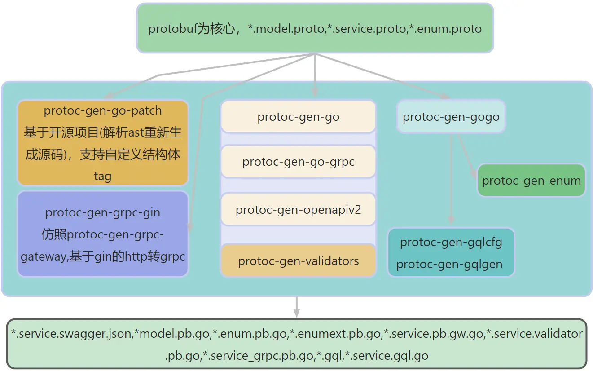

# protobuf

[](https://pkg.go.dev/github.com/hopeio/protobuf)
[](https://go.dev/)
[](LICENSE)
[](https://hub.docker.com/r/jybl/protogen)

**One `.proto`. gRPC · HTTP · OpenAPI · validation.**  
hopeio 的 Protobuf 工具链：内置公共 `_proto`、`protogen` CLI，以及 gateway / validator / go-patch 等插件——把服务契约一次写清，多端代码一次生成。



```bash
go get github.com/hopeio/protobuf@latest
```

> 本仓库是 **Go module `github.com/hopeio/protobuf`**（proto 定义 + 插件 + 生成辅助包）。  
> 各业务前端的 TS 生成包装（如 RFV 的 `@hopeio/pb`）是**消费方仓库**，不在这里写业务逻辑。

## 你能得到什么

| 能力 | 说明 |
|------|------|
| **protogen** | 一键编排 `protoc` 插件（Go / 可选 Dart · TS） |
| **HTTP Gateway** | `protoc-gen-gateway`：`framework=nethttp\|gin\|fiber` |
| **Validator** | 从 proto 注解生成请求校验代码 |
| **OpenAPI** | 集成 grpc-gateway `protoc-gen-openapiv2` |
| **go-patch** | 结构体 tag、自定义方法等 AST 级增强 |
| **公共消息** | `hopeio/request` · `response` · `model` · `validator` |
| **Vendored includes** | `_proto` 内含 googleapis 子集、well-known types、OpenAPI options、protopatch |

与 [mix](https://github.com/hopeio/mix) 的 `gateway` / `ErrResp` 对齐，生成代码开箱可挂。

## 5 分钟上手

### 1. 安装插件

```bash
go get github.com/hopeio/protobuf@main
go run "$(go list -m -f '{{.Dir}}' github.com/hopeio/protobuf)/tools/install_tools.go"
```

将安装：`protogen`、`protoc-gen-go`、`protoc-gen-go-grpc`、`protoc-gen-go-patch`、`protoc-gen-openapiv2`、本仓 `protoc-gen-gateway` / `protoc-gen-validator`。  
另需本机 [protoc](https://github.com/protocolbuffers/protobuf/releases)。

### 2. 生成

```bash
protogen go -d -w -v -i ./proto -o ./gen
```

| 标志 | 含义 |
|------|------|
| `-i` / `--proto` | proto 输入目录 |
| `-o` / `--output` | 生成输出目录 |
| `-d` / `--openapi` | OpenAPI |
| `-w` / `--gateway` | HTTP Gateway |
| `-v` / `--validator` | 校验代码 |
| `-I` / `--include` | 额外 include |
| `-p` / `--protobuf` | hopeio `_proto` 路径 |
| `--framework` | `nethttp`（默认）· `gin` · `fiber` |

子命令：`protogen go` · `protogen dart` · `protogen ts`。

### 3. Docker（无需本地装插件）

```bash
docker run --rm -v "$PWD:/work" jybl/protogen \
  protogen go -d -w -v -i /work/proto -o /work/gen
```

## Proto 长什么样

```protobuf
syntax = "proto3";
package user;

import "google/api/annotations.proto";
import "protoc-gen-openapiv2/options/annotations.proto";
import "hopeio/request/param.proto";
import "patch/go.proto";

option go_package = "example/user";

service UserService {
  rpc Info (hopeio.request.Id) returns (User) {
    option (google.api.http) = { get: "/api/user/{id}" };
    option (grpc.gateway.protoc_gen_openapiv2.options.openapiv2_operation) = {
      summary: "获取用户信息"
    };
  }
}

message User {
  uint64 id = 1 [(go.field) = {tags: 'gorm:"primaryKey;"'}];
  string name = 2 [(go.field) = {tags: 'gorm:"size:64;not null"'}];
}
```

生成物可直接对接 **mix**：gRPC 注册 + `mix/gateway.UnaryCall`（或 gin/fiber contrib）挂 HTTP。

## 仓库结构

```
_proto/           # 公共 / vendored proto（hopeio + google + patch + openapi）
model/            # 生成后的 model（含 timestamp/duration 扩展）
request/          # Id · Pagination · Cursor …
response/         # CommonResp · ErrResp（桥接 mix）
utils/            # validator / apiconfig / openapiconfig
protogen/         # 插件侧 option helper
tools/
  protogen/           # CLI
  protoc-gen-gateway/ # 多框架 HTTP 代理生成
  protoc-gen-validator/
  install_tools.go
  docker/
copyproto.sh      # 从 module cache 同步外部 proto → _proto（维护用）
```

## 维护本仓生成物

```bash
go run ./tools/generate.go
# 同步上游 proto 定义
./copyproto.sh
```

构建镜像：

```bash
./tools/docker/docker_build_local.sh "$GOPATH" "$PROTOC" jybl/protogen
```

## hopeio 生态

```
  .proto  ──protogen──►  *.pb.go + gateway + openapi + validator
                              │
                              ▼
                         mix.Server   （同端口 HTTP + gRPC）
                              │
                         initialize   （配置 / DAO，可选）
                              │
                            gox       （日志、HTTP、工具）
```

| 仓库 | 关系 |
|------|------|
| [gox](https://github.com/hopeio/gox) | 运行时依赖（log / validator / 时间等） |
| [mix](https://github.com/hopeio/mix) | Gateway 生成 import；`ErrResp` 对齐 |
| [initialize](https://github.com/hopeio/initialize) | **无直接依赖**；负责进程配置与 DAO |

## License

[MIT](LICENSE) · Copyright © hopeio
